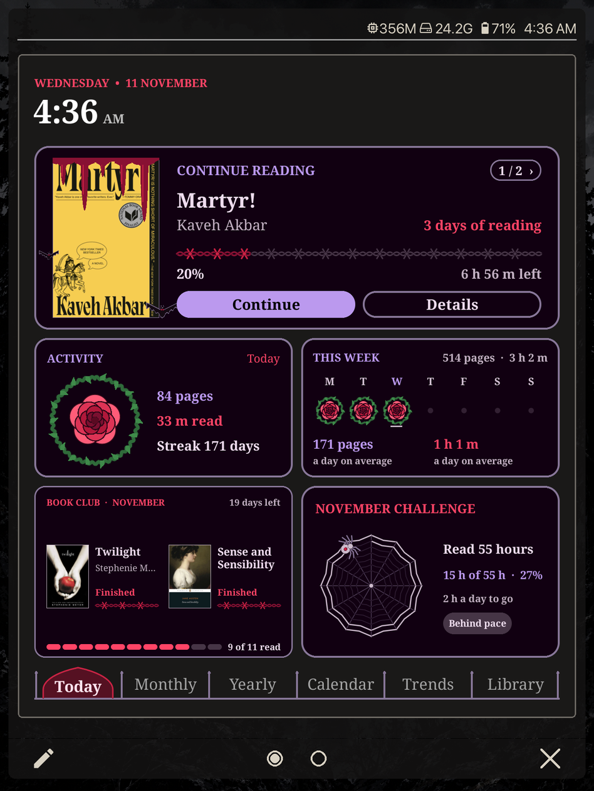
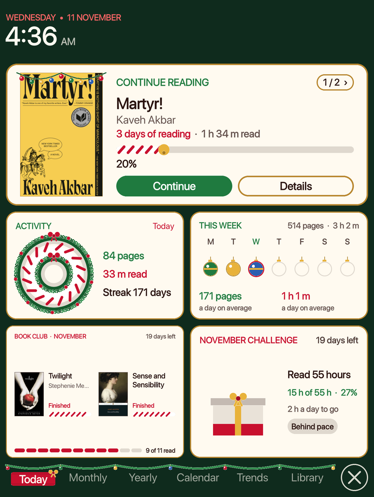
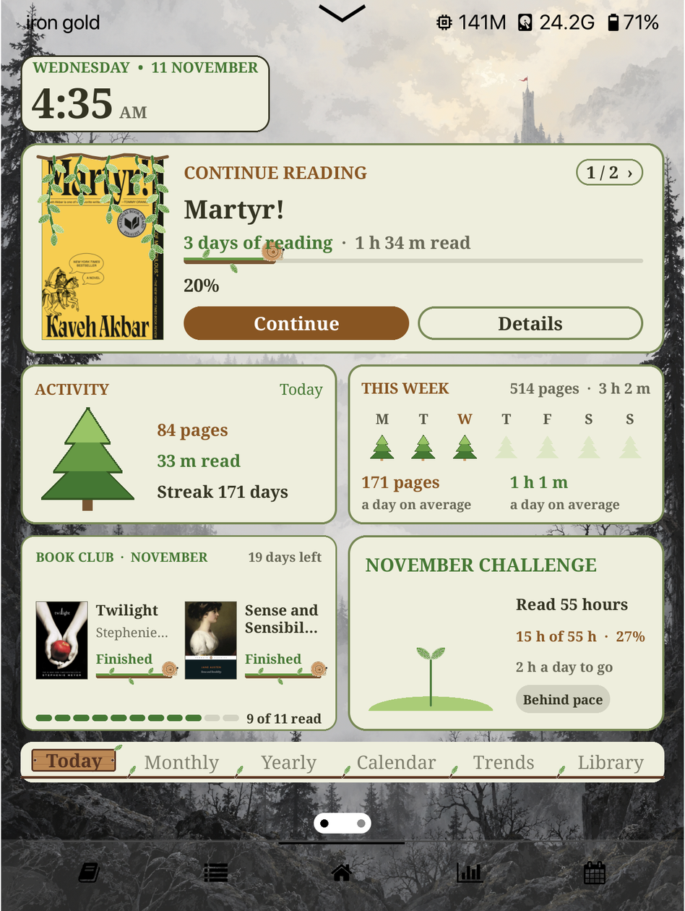
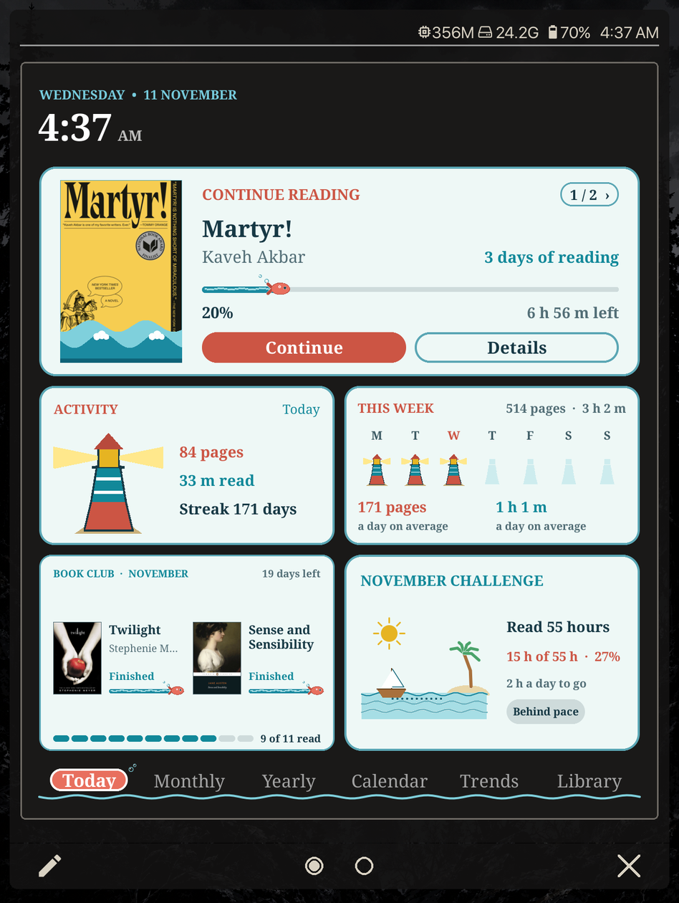
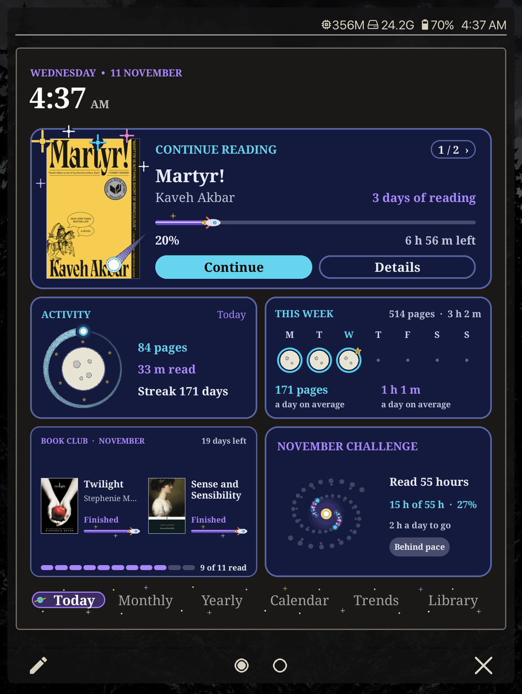
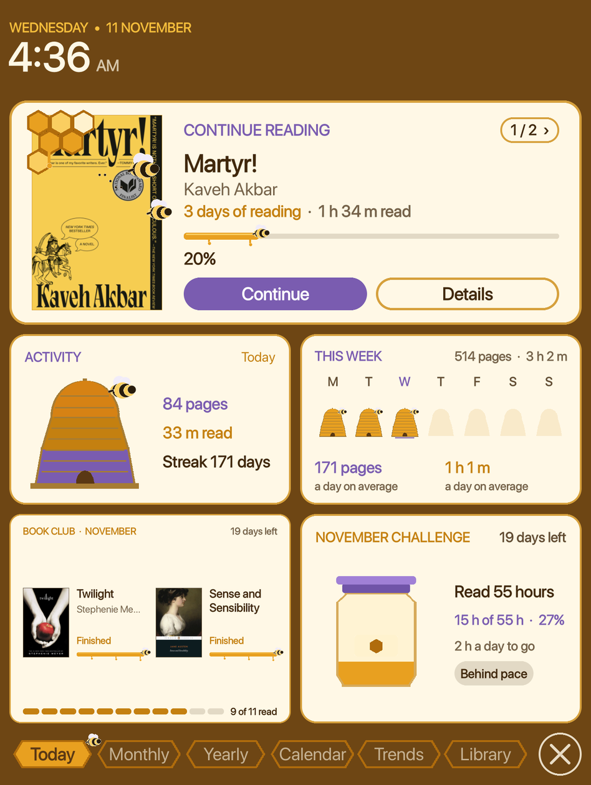
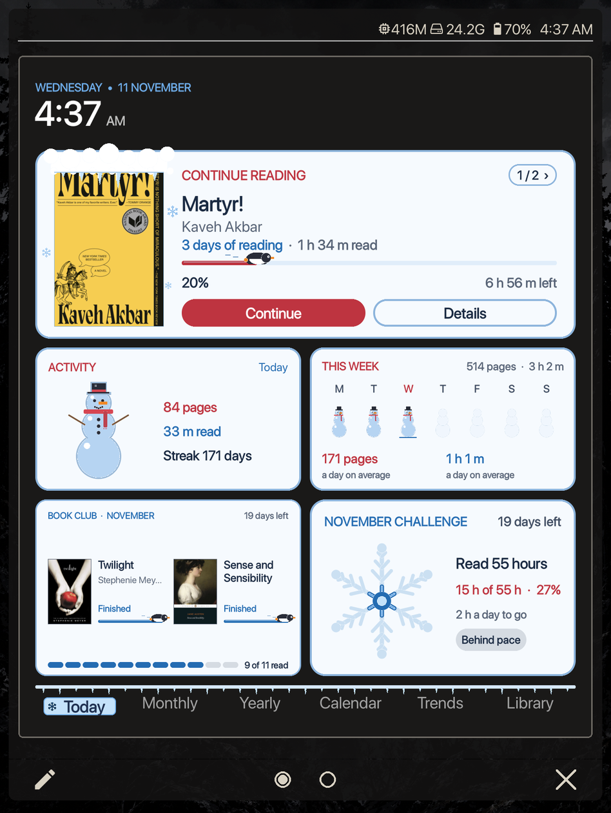
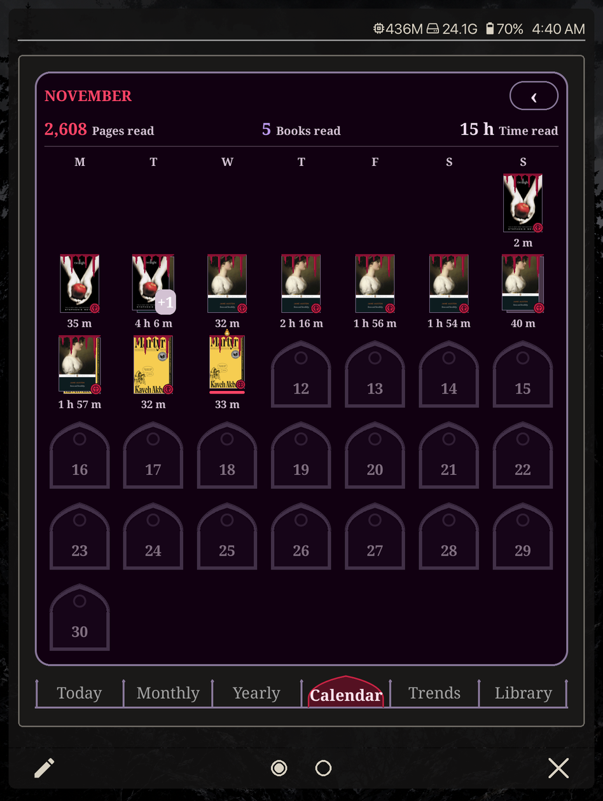
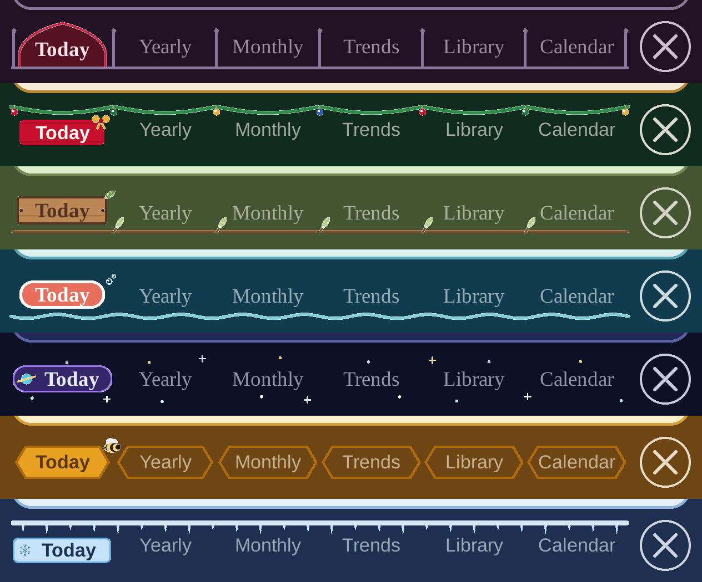

# Reading Log styles

**Styles you can download for [Reading Log](https://github.com/stevenzamora1/reading-log),
the reading dashboard for KOReader.** Each one redraws the activity rings,
the days of the week, the goals, the progress bars, the Monthly challenge,
the calendar, the book covers and the Dashboard's tabs, and brings its own
colours.

<p align="center">
  
  
  
  
</p>
<p align="center">
  
  
  
  
</p>

## Get them

On your reader, with Reading Log 1.5.0 or newer: Tools > Reading Log >
Styles and colours > **Get more styles…**. Tap a style to download it; it
shows up in the Style list next to Default, Cute, Cyber and Dark Academia.
Tap it again later to update it or remove it.

Any style can also go on White, Dark or Paper instead of its own colours:
Styles and colours > **Colours**.

Nothing here needs a new Reading Log release: a style is live as soon as
it's on the `main` branch.

<p align="center">
  
</p>

## The styles

| Style | What it draws |
| --- | --- |
| **Christmas** | A wreath and a candy cane for the rings, baubles for the days, a tree for the year goal, presents for the bar charts, lights for the lines, an advent calendar, a present that opens to a book for the challenge; a string of lights along the top of the covers on Continue reading and the calendar; a garland with baubles along the Dashboard's tabs, the open one tied with a red ribbon and a gold bow. |
| **Gothic** | A big rose for the rings whose petals fill in with your pages, inside a thorny vine with a curled tendril that grows round it with your minutes; roses for the days that gain a ring of thorns once both goals are met, barbed wire for the progress bars, a marked vial in a pointed arch for the year goal, lancet windows for the bar charts and the calendar, crosses and diamonds for the lines, candles on Today's timeline, a spider spinning its web for the challenge; blood dripping down the covers on Continue reading and the calendar, with bats flying off its sides on Continue reading; a wrought-iron fence along the Dashboard's tabs, the open one under a pointed arch. |
| **Forest** | A pine tree for the rings, its bottom, middle and top tiers filling with pages, minutes and the streak; small pines for the days (their trunks turn oak once the day's minutes are read), a snail on a mossy branch for the progress bars, a woodpile that gains a log per book for the year goal, trees for the bar charts, a leafy vine and acorns for the lines, mushrooms on Today's timeline, wooden signs for Reading trends, wood slices for the calendar, an acorn that grows into an oak for the challenge; vines hanging over the cover on Continue reading; a branch along the Dashboard's tabs, the open one a wooden sign. |
| **Ocean** | A lighthouse for the rings (base, tower and lamp room fill with pages, minutes and the streak; the lamp shines once pages and minutes are done), small lighthouses for the days, a fish swimming along the progress bars, a treasure chest of pearls for the year goal, columns of sea for the bar charts, shells and bubbles for the lines, fish on Today's timeline, portholes for the calendar, a sailboat crossing to an island for the challenge; waves along the bottom of the covers on Continue reading and the calendar; a wave along the Dashboard's tabs, the open one a lifebuoy. |
| **Space** | The moon waxing in the middle (pages) with a comet flying round it (minutes) for the rings, the moon waxing for the days, a rocket along the progress bars, a star cluster that lights a star per book for the year goal, columns of light for the bar charts, stars and little planets for the lines, twinkles on Today's timeline, ringed planets for Reading trends and the calendar, a spiral galaxy whose stars light up for the challenge; stars spilling over the covers on Continue reading and the calendar, with a comet across the corner; stars along the Dashboard's tabs, the open one a capsule with a ringed planet. |
| **Honey** | A straw beehive for the rings (its three bands fill with pages, minutes and the streak; a bee comes out once the streak is full), little hives for the days, a honeycomb whose cells fill per book for the year goal, a bee along a honey drip for the progress bars, honeycomb cells for the calendar and Reading trends, and a honey jar filling for the challenge; honeycomb and bees on the cover on Continue reading; honeycomb cells for the Dashboard's tabs, the open one full of honey with a bee. |
| **Winter** | A snowman for the rings (it packs with snow with your pages, gets its face (scarf, eyes, carrot nose) with your minutes, and its top hat fills with the streak), little snowmen for the days, an igloo that gains an ice block per book for the year goal, a penguin sliding along the progress bars, frosty panes for the calendar, snowflake tiles for Reading trends, snow and icicles on the covers on Continue reading and the calendar, and a snowflake whose arms grow out and frost in for the challenge; snow and icicles along the Dashboard's tabs, the open one a frosted pane with a snowflake. |

On the reader, a downloaded style goes to
`koreader/settings/readinglog/styles/<id>/`. You can also copy a style's
folder there by hand to try it before putting it here.

## The built-in styles

`index.json` also lists **Cute**, **Cyber** and **Dark Academia**. They
are built into Reading Log, so there's nothing to download: their entries
have `"builtin": true` and no `files`, and only their name and description
are read. In Get more styles they show as "built in", with a button to take
them off the Style list or put them back. Only these three ids can be
built in.

```json
{ "id": "cute", "builtin": true, "name": "Cute", "description": "..." }
```

## On the reader

Tools > Reading Log > Styles and colours > **Your styles…** works
without Wi-Fi: it takes the
built-in styles off the Style list or puts them back, and deletes
downloaded styles from the device (they can be downloaded again).

## Add a style

What's in here:

```
index.json            the list the plugin shows
images/               the screenshots in this README
christmas/
  style.lua           name, colours, card looks
  draw.lua            drawings (optional)
gothic/  forest/  ocean/  space/  honey/  winter/
                      the same two files each
```


1. Make a folder named after the style's id: lower case, `a-z`, `0-9` and
   `_` only (`gothic`, `winter_night`).
2. Put a `style.lua` in it (see below) and, if it draws anything of its
   own, a `draw.lua`.
3. Add it to `index.json`: its `id`, `version`, `name`, `description`, and
   the `files` to download (always `style.lua`, plus `draw.lua` if there is
   one).
4. Push to `main`. Readers see it the next time they open Get more styles.

**Updating a style:** change its files and raise its `version` in both
`style.lua` and `index.json`. Readers who have it see "update" next to it.

**Removing a style:** take it out of `index.json` (and delete its folder).
Readers who already have it keep it until they remove it.

## style.lua

```lua
return {
    api = 1,                        -- the format version (1 for now)
    id = "christmas",               -- the same as the folder's name
    version = "1.0",
    name = "Christmas",
    names = { es = "Navidad", fr = "Noël", pt_br = "Natal", it = "Natale" },
    description = "One line about it.",
    descriptions = { es = "...", fr = "...", pt_br = "...", it = "..." },
    author = "Steven",

    -- optional: start from a built-in style's card looks (cute, cyber,
    -- academia), then change any of them
    base = "cute",
    looks = { quote_look = "paper", timeline_look = "default" },

    -- optional: the style's own theme. Switching to the style puts it on;
    -- switching away puts back the theme from before.
    theme = {
        surface = { 255, 250, 240 },   -- the card
        tint = { 243, 233, 214 },      -- a tinted card
        fg = { 42, 20, 16 },           -- the ink
        border = { 184, 134, 46 },     -- the frame
        page = { 15, 43, 29 },         -- the Dashboard's page
        page_fg = { 255, 250, 240 },   -- headings and tabs on the page
        thin = false, square = false, serif = false,
        accent  = { label = "Holly red",  deep = { 200, 16, 46 }, bright = { 255, 102, 102 } },
        accent2 = { label = "Pine green", deep = { 31, 122, 63 }, bright = { 102, 204, 119 } },
    },

    draw = "draw.lua",              -- optional
}
```

- Colours are `{ red, green, blue }`, 0 to 255. On colour e-ink, multiples
  of 17 (0, 17, 34 … 255) show without grain.
- An accent can also be a built-in one by name: `"red"`, `"gold"`, `"teal"`…
  `deep` is used on light cards, `bright` on dark ones.
- Card looks: any look a card already has, by its setting name, for
  example `ring_shape = "hearts"`, `challenge_style = "flower"`,
  `quote_look = "paper"`, `chart_look = "candles"`. `"default"` means the
  plain look. The built-in styles' lists in Reading Log's
  `readinglog/settings.lua` (`CUTE`, `CYBER`, `ACADEMIA`) show every
  setting and value.

## draw.lua

Optional. It returns a table of drawing functions; each one is optional.
When a function is missing, or returns `false`, the usual drawing is used.

```lua
local D = {}

-- One ring of a rings card (Activity, Week, Month rings, the Mini
-- dashboard): centre, radius, thickness, how full (0 to 1), the empty and
-- filled colours, the card's colours, and which ring it is: 1 = pages,
-- 2 = time, 0 = another one (the streak).
function D.ring(c, cx, cy, R, t, frac, track, fill, tone, which) end

-- A book's progress bar (Continue reading, Book club).
function D.bar(c, x, y, w, h, frac, tone, fill) end

-- The Monthly challenge's centrepiece, in a circle of radius R. The
-- percentage is written next to it.
function D.challenge(c, cx, cy, R, frac, tone, fill) end

-- One day of the Week and Month rings, in a d x d box. fp and fm: how far
-- the day got to the pages and minutes goals (0 to 1, or more).
-- o = { today, future, past, small }
function D.day(c, cx, cy, d, fp, fm, tone, o) end

-- The Year goal's picture, in the box on the card's left.
function D.goal(c, x, y, w, h, done, target, tone) end

-- One bar of a bar chart (Time read by month, Pages per day, This week),
-- standing on y + h. o = { current, i }
function D.chartBar(c, x, y, w, h, tone, fill, o) end

-- One line of the Books and pages chart: pts = { x1, y1, ... } along the
-- curve, xs/ys the n month points. o = { series = 1 (books) or 2 (pages) }
function D.line(c, pts, xs, ys, n, lw, fill, tone, o) end

-- The strip of Today's timeline: spans = { { from, to, colour } } as
-- fractions of the strip, now = where now is (0 to 1, or nil).
function D.timeline(c, x, y, w, h, spans, now, tone) end

-- Reading trends: the tile behind a trend, and its round mark
-- (dir = "up", "down" or "flat").
function D.trendTile(c, x, y, w, h, tone, i) end
function D.trendBadge(c, cx, cy, r, dir, tone, fill) end

-- The calendar: a day with no reading (o = { today, future, num_px }),
-- and dressing a day's cover after it's drawn (o = { today }).
function D.calendarEmpty(c, x, y, w, h, n, tone, o) end
function D.calendarCover(c, x, y, w, h, tone, o) end

-- Continue reading: dressing the book's cover after it's drawn
-- (o = { pct }, how far through the book, 0 to 1). Reading Log 1.5.0 and up.
function D.bookCover(c, x, y, w, h, tone, o) end

-- The Dashboard's row of tabs along the bottom of its page (Reading Log
-- 1.5.0 and up). x, y, w, h is the whole row; cells has one entry per tab:
-- { x, w, i, active, label_w, label_h }. Draw the bar and mark the open
-- tab; Reading Log writes the tab names on top afterwards, centred in each
-- cell. Set cell.color to change a name's colour, cell.dx / cell.dy to move
-- it. tone is the page's colours (bg, fg, muted, track, accent, accent2, dark).
function D.tabBar(c, x, y, w, h, cells, tone) end

return D
```

Drawing tools on `c`, the card's canvas (colours are `{r,g,b}`):

| Call | Draws |
| --- | --- |
| `c:ring(cx, cy, R, t, frac, track, fill)` | a ring, filled from the top clockwise |
| `c:disc(cx, cy, r, colour)` | a filled circle |
| `c:rrect(x, y, w, h, radius, colour)` | a filled rounded rectangle |
| `c:frame(x, y, w, h, radius, line, border, fill)` | a framed rounded rectangle |
| `c:rect(x, y, w, h, colour)` | a filled rectangle |
| `c:polyline({x1, y1, x2, y2, …}, width, colour)` | a line through points |
| `c:label(text, size, x, y, { bold, anchor = "c", valign = "mid", color })` | text |

There is no general shape fill: build shapes from rows of `c:rect` (see
the Christmas tree and baubles in `christmas/draw.lua`), discs and lines.

`tone` has the card's colours: `bg`, `fg`, `muted`, `track`, `accent`,
`accent2`, `btn`, and `dark` (true on a dark card).

**What a style can do:** style files run with only `math`, `string` and
`table`. They can't open files, use the network or run commands, so a
style can draw and nothing else. If a drawing fails, Reading Log uses the
usual one and writes the error to `crash.log` once.

**Keep it light:** the Week and Month rings draw a ring for every day, so
a ring drawing runs up to 62 times for one card. Draw small rings simply
(the Christmas wreath skips its needles below a radius of 22).

## index.json

```json
{
  "api": 1,
  "styles": [
    {
      "id": "christmas",
      "version": "1.0",
      "api": 1,
      "name": "Christmas",
      "names": { "es": "Navidad" },
      "description": "One line about it.",
      "descriptions": { "es": "..." },
      "author": "Steven",
      "files": ["style.lua", "draw.lua"]
    }
  ]
}
```

File names may only use letters, digits, `_`, `-` and one dot. The plugin
checks a downloaded `style.lua` (its `id`, its `api`) before it replaces
the old copy.
